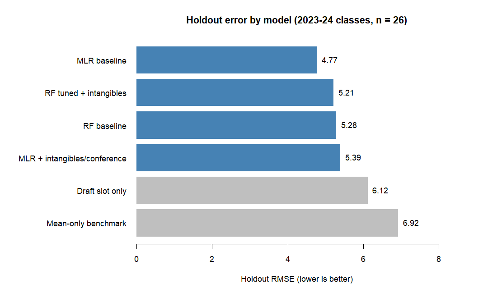
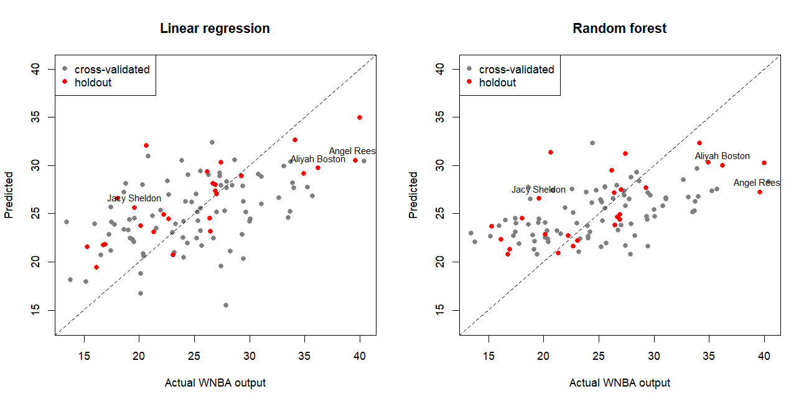
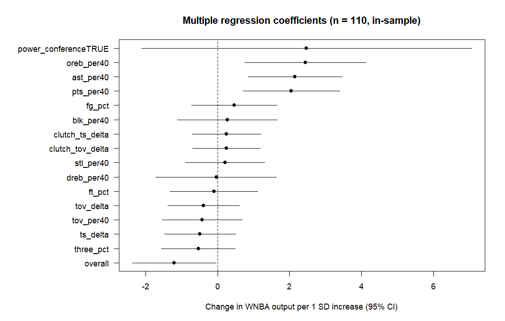
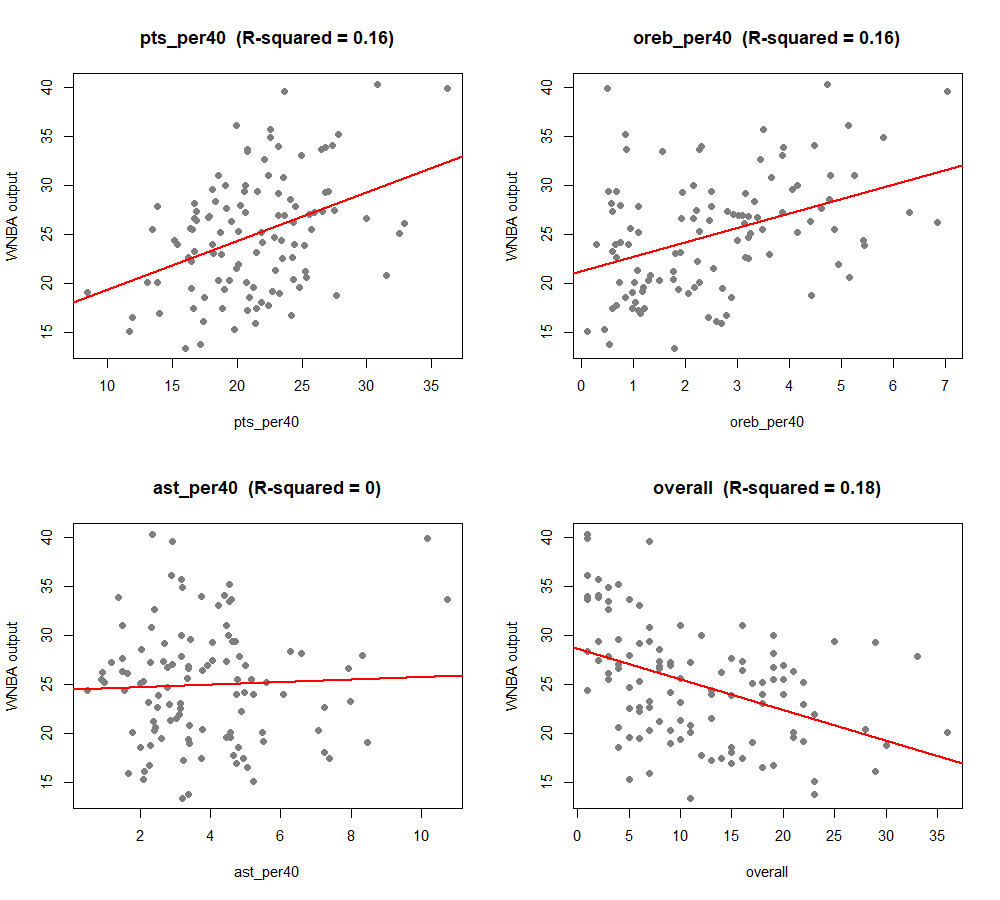
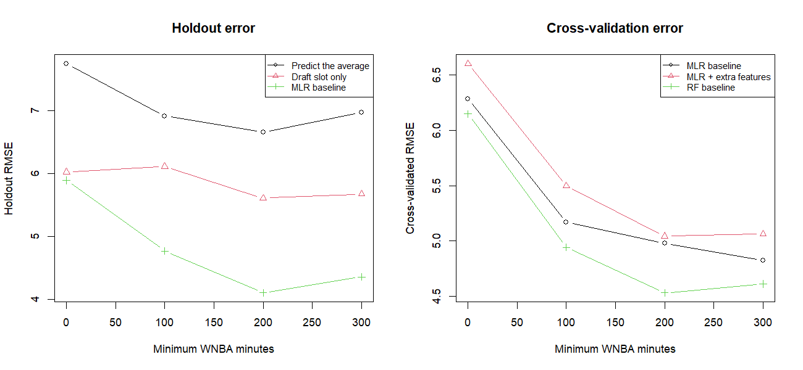
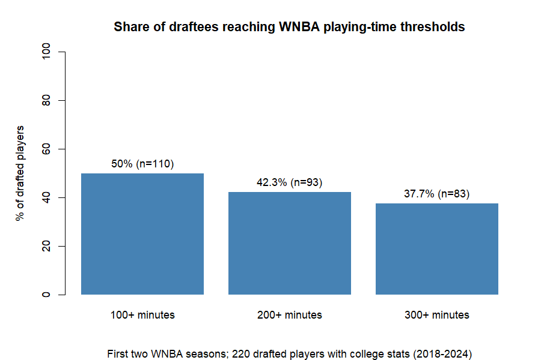

# WNBA Prospect Translation

## What's the point of this?
Do college box-score stats predict early WNBA production beyond draft slot, and do high-pressure/clutch proxies add anything?

I wanted to check what stats or features were indicators of a prospect's performance at the highest level. What numbers would remain virtually unchanged and, alongside that, be a very good indicator of the other output profiles? I also wanted to test a theory that "clutch" players tend to perform better on average.

## Project goal

**Main question:** Do college box-score stats predict early WNBA production beyond what the draft slot already tells us?

**Second question:** Do box-score proxies for pressure and clutch performance add any predictive value?

**Why it matters:** From a raw fan perspective, I have noticed the W is one of the least covered leagues on the planet in terms of statistical research.

**Scope:** Drafted players, 2018-2024 classes; production measured over the first two WNBA seasons.

**Why I did it:** I wanted to check what stats or features were indicators of a prospect's performance at the highest level, what numbers would remain virtually unchanged and, alongside that, be a very good indicator of the other output profiles. I also wanted to test a theory that "clutch" players tend to perform better on average.

## Summary of findings

| Question | Answer | Confidence |
|---|---|---|
| Do college stats predict early WNBA production beyond draft slot? | Yes. On the 2023-24 holdout, a regression using college stats and draft slot missed by about 4.8 on average, versus 6.1 for draft slot alone and 6.9 for predicting the average. | Solid on direction; the holdout is only 26 players |
| Which stats matter most? | Scoring, offensive rebounding and assists per 40 minutes were the clearest drivers. | Moderate |
| Which stats carry over most consistently from college to the WNBA? | Rebounds, blocks and assists (correlations of 0.78 to 0.87). Points carry over least (0.42). | Moderate; descriptive, and partly reflects position and role |
| Do box-score pressure/clutch proxies add predictive value? | No detectable effect, but the test was underpowered. Inconclusive, not absent. | Solid null for these proxies only |
| Are power-conference players favored in the draft? | They were drafted about 12 picks earlier than their stats alone predict. Conference did not predict WNBA output beyond stats and draft slot. | Strong association; cause unknown |
| Regression or random forest? | A tie. | Low |

## Data
- Sources: ESPN via the `wehoop` R package (college 2014-2024, WNBA 2014-2025, drafts 2018-2024)
- Sample: 220 drafted players with college stats; 143 logged any WNBA minutes in their first two seasons; 110 logged 100 or more (the primary sample)
- Split: 84 players from the 2018-2022 classes for training and cross-validation; 26 players from the 2023-2024 classes held out for a final check
- Outcome: per-40 points + rebounds + assists + steals + blocks over the first two WNBA seasons (an unweighted production index, not an advanced metric)

## Method
- **Features:** per-40 rates (points, offensive and defensive rebounds, assists, steals, blocks, turnovers), shooting percentages, draft slot (overall pick, 1-36), a power-conference flag, and box-score proxies for pressure and clutch performance
- **Pressure proxy:** a player's true shooting percentage and turnover rate in postseason games minus the same in regular-season games
- **Clutch proxy:** the same changes in games decided by 5 points or fewer versus all other games
- **Models:** multiple linear regression and a random forest (`ranger`, tuned over a small grid), each with and without the pressure, clutch and conference features
- **Validation:** leave-one-draft-year-out cross-validation on 2018-2022, then a final check on 2023-2024
- **Sensitivity:** every key test was repeated requiring 0, 100, 200 and 300 minimum WNBA minutes, because per-40 rates from a few minutes are noise

## Results

### Holdout error by model

*Average prediction miss (RMSE) on the 2023-24 draft classes (26 players). Lower is better. Grey bars are benchmarks.*

| Model | Holdout RMSE |
|---|---|
| Predict the average | 6.92 |
| Draft slot only | 6.12 |
| Regression: stats + draft slot | **4.77** |
| Random forest: stats + draft slot | 5.28 |
| Random forest + pressure/clutch/conference | 5.21 |
| Regression + pressure/clutch/conference | 5.39 |

The regression using college stats and draft slot missed by about 4.8 on average, compared with 6.1 for draft slot alone and 6.9 for predicting the average. The four stats-based models are within noise of one another with only 26 players, so I treat them as a tie. The gap between those four and the two benchmarks is larger than the gaps among them, and that is the result I lean on. In cross-validation (84 players) the random forest was slightly better (4.93 versus 5.17 for the regression), so neither model class wins consistently.

### Predicted versus actual

*Each dot is a player, using only predictions made without seeing that player (grey: cross-validated, red: holdout). Dots on the dashed line are perfect predictions.*

Both models give loose clouds, consistent with a typical miss of about 5. The random forest's predictions are squeezed into a narrower band than the regression's (roughly 21-33 versus 15-35 as I read the chart). It averages many trees and avoids extreme values, so a tighter cloud there does not mean a more accurate one.

### What drove the predictions

*Multiple regression coefficients per one standard deviation, with 95% intervals (n = 110, fit on all players, so descriptive). The conference flag is a yes/no variable.*

Scoring (p = 0.003), offensive rebounding (p = 0.005) and assists (p = 0.002) per 40 were clearly positive, and later draft slots were associated with lower output (p = 0.04). The conference flag and all four pressure and clutch features have intervals that cross zero, which means the data cannot distinguish them from no effect. The model explains about 46% of the variation in this sample (about 37% adjusted for the number of predictors). Several predictors overlap heavily (defensive rebounds correlate 0.72 with both offensive rebounds and blocks), so individual coefficients for those stats are unstable.

*One stat at a time against WNBA output, with the fitted line and R-squared.*

On its own, points per 40 and offensive rebounds per 40 each explain about 16% of the variation, and draft slot about 18%. Assists explain almost none by themselves, even though assists were significant in the multiple regression. Assist-heavy players are mostly guards with few rebounds, and the outcome adds up rebounds and assists, so the two roles cancel when assists are viewed alone. Holding the other stats fixed, assists matter. This is the difference between a simple and a multiple regression.

### Which stats carry over from college to the WNBA

| Stat (per 40) | Correlation, college vs WNBA |
|---|---|
| Rebounds | 0.87 |
| Blocks | 0.83 |
| Assists | 0.78 |
| Steals | 0.56 |
| Points | 0.42 |

*n = 110 players with 100+ WNBA minutes.*

<!-- Add the chart here once saved:  -->

Rebounding, blocking and passing rates stay the most consistent across levels, and scoring the least. This is a measure of how well a player's ranking holds up, not whether the numbers stay the same, and much of it likely reflects position and role (bigs rebound and block at both levels, guards pass) more than a skill transferring on its own.

### Sensitivity to the minutes cutoff

*The same comparison rerun on players with at least 0, 100, 200 and 300 WNBA minutes (143, 110, 93 and 83 players). Compare lines within a panel, not across cutoffs.*

Every line falls as the cutoff rises, because outcomes from more minutes are less noisy, not because the models improve. What holds at every cutoff is the order: predicting the average is worst, draft slot is next, the stats-based regression is best, and adding the pressure, clutch and conference features never helps.

### Did they stick?

*Share of the 220 drafted players (with college stats) reaching each total-minutes threshold in their first two WNBA seasons.*

65% logged any WNBA minutes, 50% reached 100, 42% reached 200 and 38% reached 300. About half of drafted players barely register in their first two seasons. This measures playing time, not staying in the league (300 minutes is roughly 10 full games), and a few of the zero-minute players may be name mismatches in the data.

### Power conference and the draft

Across all 220 drafted players, a power-conference school was associated with being drafted about 12.5 picks earlier than college stats alone would predict (p < 0.001). That did not translate into production: conference did not predict WNBA output beyond stats and draft slot (p = 0.33, and the closest any cutoff came to 0.05 was 0.09), and only a minutes-weighted version of the model flagged it (p = 0.03). So I treat the production question as unresolved. The draft result is an association, not proof of favoritism: height, age and team success are not in the data, and these players are not shown to have underperformed their slot.

## inconclusive

- **Pressure and clutch proxies.** These showed no predictive value in any test: the joint test for the added features gave p = 0.59, they added nothing beyond conference (p = 0.60), they made out-of-sample error worse in cross-validation (5.17 to 5.50) and on the holdout (4.77 to 5.39), and they never reached p = 0.05 at any minutes cutoff. But the test had little power. The proxies rest on a median of about 41 postseason shot attempts, 23% of players had no postseason shots at all (set to zero), and the values swing widely (true shooting changes from about -0.47 to +0.27). They are also confounded with opponent strength, since postseason and close games are played against better teams. So the honest conclusion is that box-score proxies built from a few dozen shots were too noisy to detect a modest effect. It does not show that pressure performance is unrelated to success.
- **Model comparison.** The regression and the random forest are a tie. Tuning the random forest improved cross-validated error by only about 0.05.
- **Mistakes I caught along the way.** An early version used the pick within a round instead of the true draft slot, a failed download silently left most college seasons out, the college data stopped before the 2023-24 classes, school names such as "Florida St" were miscoded in the conference flag, and early cross-validation folds included the holdout years. All were fixed, and every number in this README comes from the corrected run.

## Limitations
- The holdout is 26 players, and it is a temporal check, not a pristine test: modeling choices were made after looking at results from all players.
- Results describe players who reached 100 or more WNBA minutes, not who makes a roster.
- The conference flag uses current conference membership, not membership at the time. The draft-slot result is correlational.
- No play-by-play data was used. The pressure and clutch features are box-score proxies only.
- The outcome is a simple sum of the same kinds of stats as the predictors, so part of what the models learn is that roles carry over between levels.
- Names are the only key linking college, WNBA and draft data, so a few players may be missing because of spelling differences, and five matches had a gap between the draft year and the final college season.
- Many comparisons were run, so I weight findings that hold across tests over any single p-value.
- The random forest results shift slightly between runs.

## Repository contents
- `full_pipeline_v4.R`: data collection, features, all model iterations
- `MODEL_GUIDE.md`: a walkthrough of every model and result
- `results/`: figures and summary tables
- `archive/`: earlier versions of the script, kept for the record

## Acknowledgements
I designed the question and the approach and did this myself, with help from Claude (an AI assistant) to debug the R code, check my statistics, and draft parts of this write-up.
